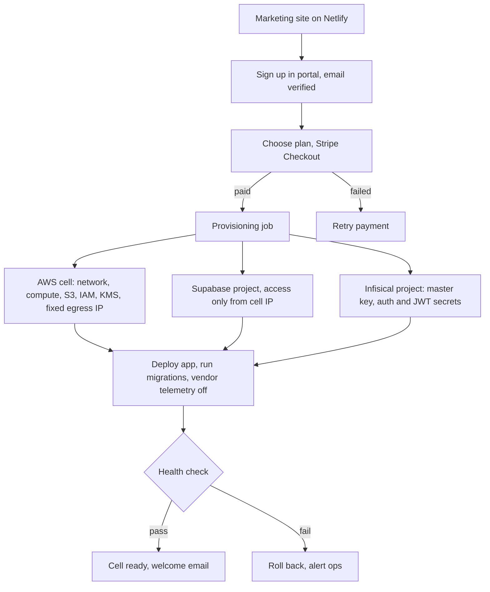
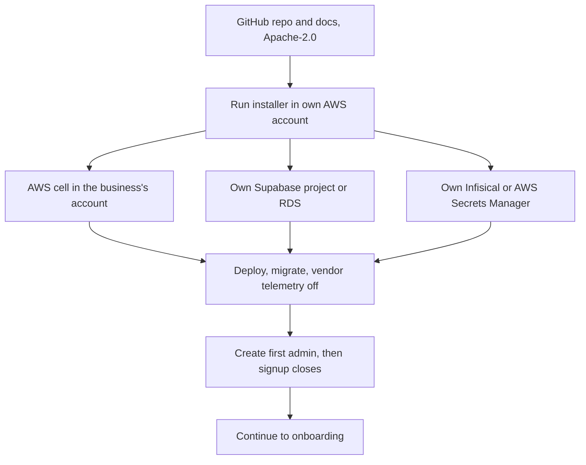
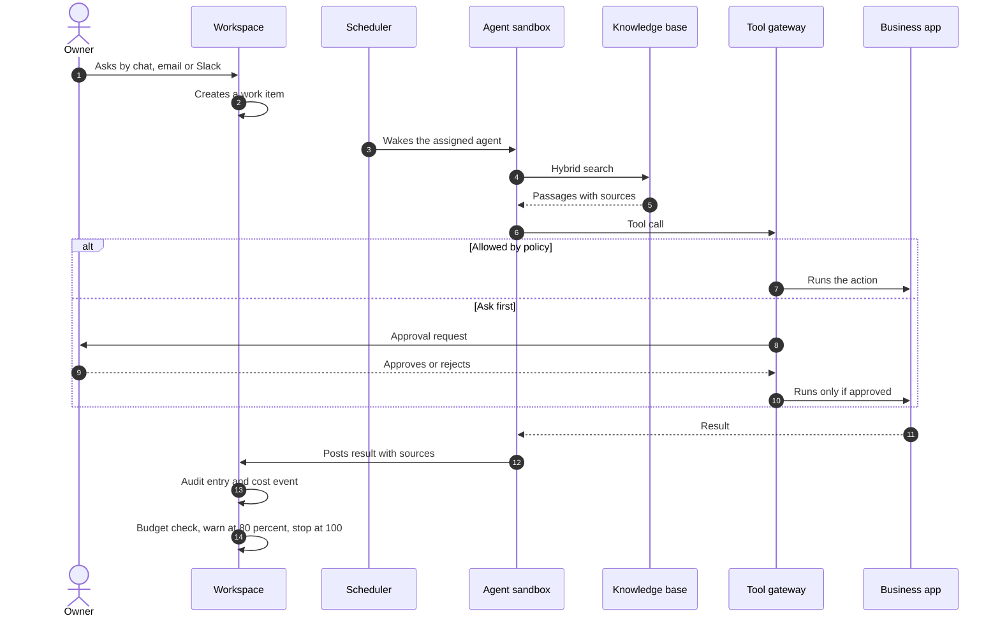
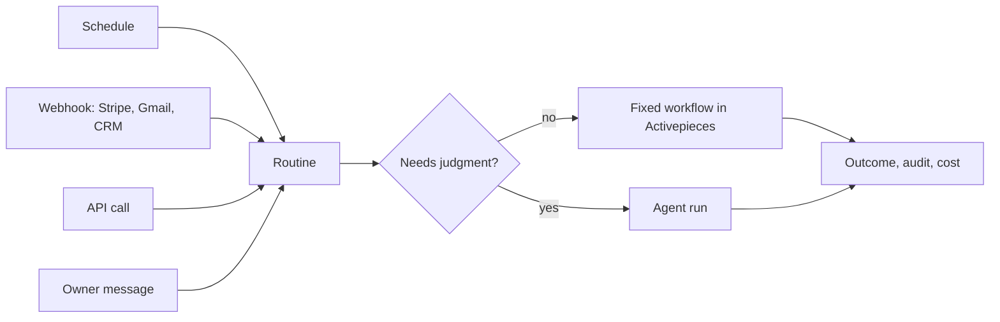
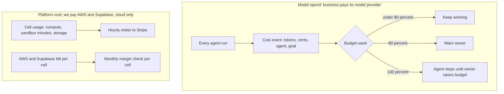
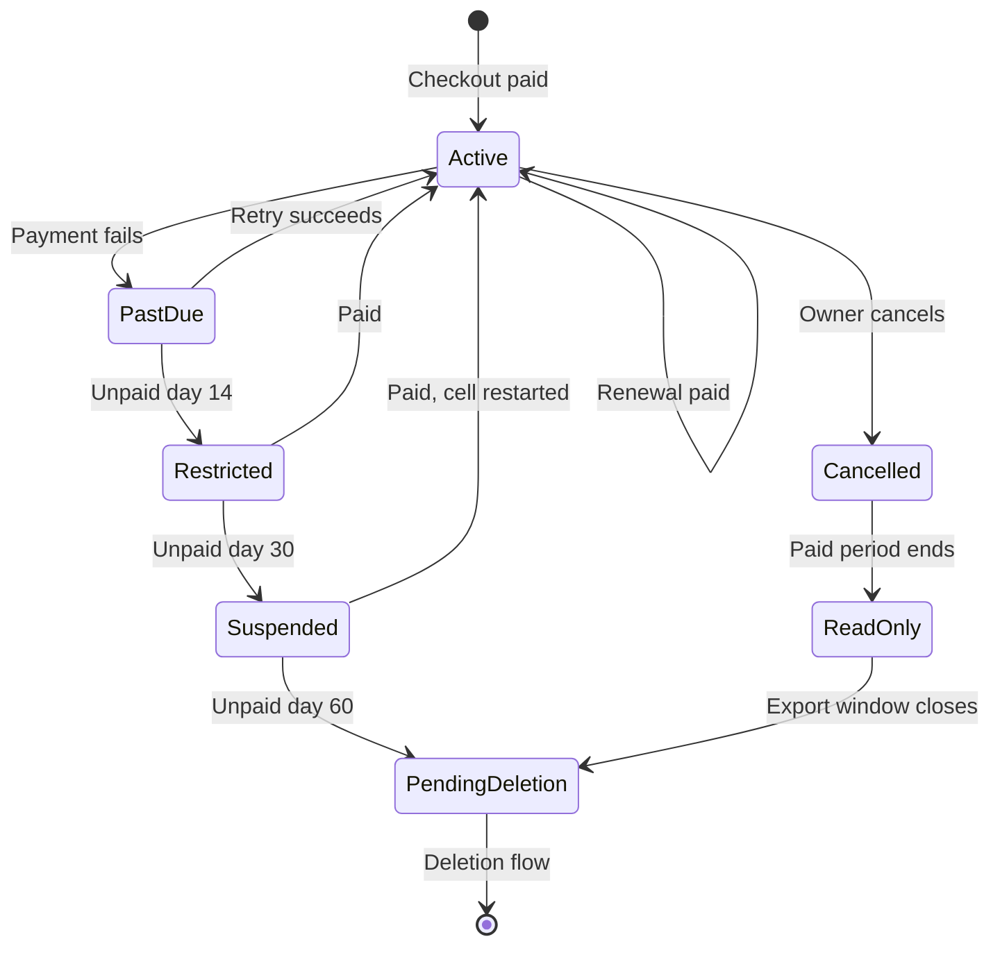
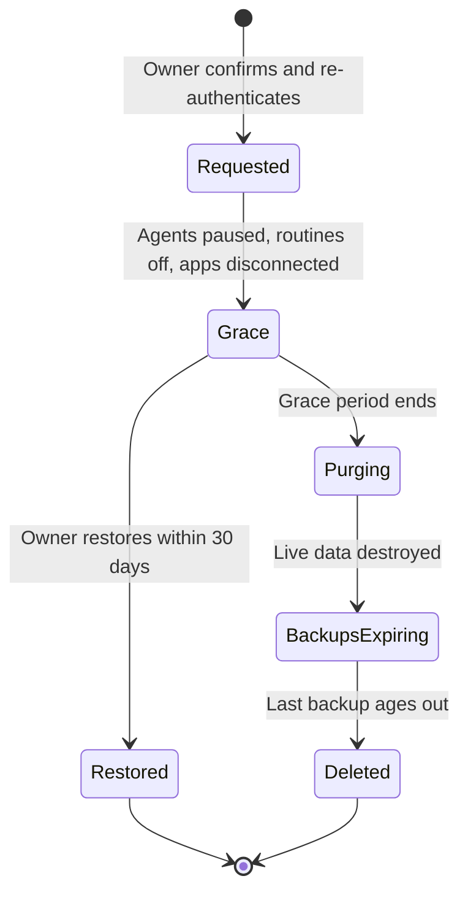

# automate.business business lifecycle

Date: 2026-11-20. Status: draft for owner review, no code built.
End-to-end flow from sign-up to account deletion for both models: the automate.business cloud (one isolated cell per business) and self-run (a business installs it in its own AWS account).
Day counts and retention periods marked *proposed* are proposals, not commitments; owner and legal decide.
Companion to `2026-11-20-paperclip-foundation-plan.md` and `2026-11-20-feature-scope.md`.

How a business moves through the system, from sign-up to account deletion, for both ways of using it: the automate.business cloud (we host one isolated cell per business) and self-run (a single business installs it in its own AWS account).

## The lifecycle at a glance

Onboarding, agents at work, automations and reports work the same way in both models.

- **Cloud** (we host and bill): Marketing site > Sign up > Plan and payment > Cell provisioned > Onboarding > Agents at work > Automations > Reports > Cost and billing > Retention > Delete with grace period

- **Self-run** (business hosts and pays AWS): GitHub and docs > Installer in own AWS > First admin > Onboarding > Agents at work > Automations > Reports > Own cost control > Own retention > Teardown

## Stage 1: Sign-up, server and setup

In the cloud, paying triggers an automated provisioning job that builds the business its own cell. Self-run businesses run the same building blocks with our installer in their own AWS account.

**Cloud**

**Self-run**

> **Note:** During development we use one shared Supabase project on the existing plan, with no real customer data. The per-business database above is the production target (issue #1).

## Stage 2: Onboarding

The owner brings their model keys, connects their apps, and teaches the system the business. This turns into skills, a knowledge base, and a team of agents with budgets and approval rules.

```mermaid
flowchart LR
  A["Owner signs in"] --> B["Add model keys, stored in Infisical"]
  B --> C["Connect apps: Google, Microsoft 365, Slack, Stripe, Xero"]
  C --> D["Onboarding interview: services, prices, policies, tone"]
  D --> E["Import documents: uploads, Drive, Notion, email"]
  E --> F["Parse, chunk, embed into knowledge base"]
  F --> G["Generate skills: SOPs, brand voice"]
  G --> H["Pick team template: roles, budgets, approval rules"]
  H --> I["First routines scheduled"]
```

## Stage 3: Agent workflow

Every piece of work follows the same loop. Agents run in a sandbox, look things up in the business's own knowledge, and act through a gateway that checks policy on every tool call. Money and messaging actions wait for the owner.

## Stage 4: Automations and scheduled jobs

Work starts from four kinds of trigger. Fixed, repeatable steps run as workflows; anything that needs judgment goes to an agent.

| Job | Runs | Where | What it does |
|---|---|---|---|
| Heartbeat scheduler | every 30 s | Cell | Wakes agents that have work or a due routine |
| Embedding queue | every 10 s | Cell database | Re-embeds changed documents |
| Knowledge sync | every 15 min *proposed* | Cell | Pulls changes from Drive, Notion, email, Microsoft 365 |
| Daily digest | daily, owner's morning | Cell | Summary of work done, waiting approvals, spend |
| Business routines | owner-defined | Cell | Example: chase unpaid invoices every Monday |
| Nightly backup | nightly | Cell to S3 | Encrypted database dump to the cell's own bucket |
| Retention purge | nightly | Cell | Removes data past its retention period (Stage 8) |
| Eval mining | nightly | Cell | Turns failures and best results into test cases |
| Reflection | weekly | Cell | Proposes instruction and skill changes for approval |
| Usage metering | hourly | Platform | Sends cell usage to Stripe (cloud only) |
| Billing and dunning check | daily | Platform | Moves overdue accounts through the billing states (Stage 7) |
| Grace period expiry | daily | Platform | Starts the purge for accounts past their deletion grace period |
| Cell health | every 5 min | Platform | Uptime, errors, disk, failed jobs per cell |
| Restore drill | monthly | Platform | Restores a backup to prove it works |

## Stage 5: Reporting

Everything an agent does produces an audit entry and a cost event. Reports are built from those, so the owner sees work, spend and results from the same records.

| Report | Audience | Contents |
|---|---|---|
| Daily digest | Owner | Work finished, approvals waiting, problems, spend so far today |
| Weekly review | Owner | Work by agent and goal, approval rate, rework, model spend against budget |
| Monthly business report | Owner | Time saved, cost per finished task, improvements applied, next month's budget |
| Live dashboard | Owner and staff | Work in progress, agent status, budgets, connected apps |
| Platform report | automate.business ops (cloud only) | Cell health, AWS and Supabase cost per cell against plan price, failed jobs |

## Stage 6: Cost management

There are two separate costs. Model spend goes from the business straight to its model provider, because the business brings its own keys; we track it and enforce budgets. Platform cost is what we pay AWS and Supabase to run the cell, which the subscription has to cover.

Self-run businesses get the same budgets and model-spend tracking. They pay AWS and their providers directly, and nothing is metered to us.

## Stage 7: Billing (cloud)

A subscription per business covers its cell, with metered add-ons for heavy usage. When a payment fails the account steps down gradually, and data is never deleted without going through the deletion flow in Stage 9. Day counts approved by the owner on 2026-11-20.

| State | Agents | Owner access | Data | Timing |
|---|---|---|---|---|
| Active | Running | Full | Kept | While paid |
| Past due | Running | Full, with a payment banner | Kept | day 0 to 14 |
| Restricted | Paused | Read-only, can pay and export | Kept | day 14 to 30 |
| Suspended | Stopped, cell compute off | Billing page and export only | Kept | day 30 to 60 |
| Cancelled | Running until period ends | Full | Kept | Until period end |
| Read-only | Stopped | Read and export | Kept | 30 days |
| Pending deletion | Stopped | Restore option during grace period | Kept until purge | See Stage 9 |

## Stage 8: Data retention policy

Each kind of data has its own retention period. The nightly purge job enforces it inside the cell. Periods marked proposed need owner and legal sign-off (issue #11).

| Data | Kept for | Where | Notes |
|---|---|---|---|
| Business workspace data (work items, documents, knowledge, skills) | While the account is active | Cell database, S3 | Owner can export at any time |
| Items the owner deletes | 30 days *proposed* | Cell | Soft delete, restorable, then purged |
| Agent run transcripts and logs | 90 days *proposed* | Cell | Redacted for secrets |
| Audit log | 1 year *proposed* | Append-only store outside the cell | Kept through the deletion grace period |
| Cost events and usage | 2 years *proposed* | Cell, platform for billing | Feeds reports and billing disputes |
| Old document versions in S3 | 30 days *proposed* | S3 lifecycle rule | Current versions kept while active |
| Supabase daily backups | 7 days | Supabase Pro plan | 14 days on the Team plan |
| Nightly database dumps | 30 days | Cell S3, encrypted | Rolling; sets the longest time deleted data can survive |
| Connection tokens and model keys | Until revoked or account deleted | Infisical | Revoked at the provider on deletion |
| Invoices, payments and account identity | 7 years *legal* | Platform and Stripe | Tax record rules; confirm per country |
| Deletion record | 7 years *legal* | Platform | Proof of what was deleted and when, no business content |

Self-run businesses get the same purge job with these defaults and can change every period. Retention is their responsibility.

## Stage 9: Delete account with a grace period

Deleting is deliberate, reversible for a grace period, and then complete: every copy is removed or ages out on a known schedule.

### Request and grace period

1. Owner chooses Delete business in the portal, signs in again and types the business name.
2. System offers a full export (documents, knowledge, work history, audit log).
3. Agents pause, routines stop, outbound app actions are disabled, and billing stops at the end of the paid period.
4. Grace period starts: 30 days. Reminder emails on day 1, 23 and 29. The owner can restore in one click.

### Purge after the grace period

1. Revoke OAuth tokens at each provider (Google, Microsoft, Slack, Stripe, Xero and others).
2. Delete the business's Infisical project, including model keys.
3. Delete the business's Supabase project.
4. Empty and delete the cell's S3 bucket, including old versions.
5. Destroy the AWS cell: compute, sandboxes, network, IAM roles, KMS keys scheduled for deletion.
6. Remove the cell from the registry and send a deletion confirmation email.
7. Backups age out within 30 days; after that no copy remains.
8. Keep only invoices and the deletion record for legal retention.

Self-run businesses use a teardown script that runs the same purge steps in their own account. We hold none of their data.

## Who does what in each model

| Area | Cloud | Self-run |
|---|---|---|
| Sign-up and identity | automate.business portal | First admin created at install |
| Servers and network | We provision and run the AWS cell | The business, with our installer |
| Database | Per-business database we provision | Their own Supabase project or RDS |
| Secrets and model keys | Per-business Infisical project | Their Infisical or AWS Secrets Manager |
| Model spend | Business pays provider directly | Business pays provider directly |
| Platform billing | Stripe subscription plus metered usage | None from us |
| Upgrades and security patches | We roll them out in waves | They pull releases from our repo |
| Backups and restore | We run and test them | Their responsibility, script provided |
| Retention and deletion | Our policy, enforced by jobs | Their policy, same jobs available |
| Support access | Only with time-limited, logged access the owner grants | None |

## Decisions

Decided by the owner on 2026-11-20:

- **No trial.** Prospects try the product in a shared demo account with sample data only. Real cells are built only for paying businesses.
- **Dunning:** past due day 0 to 14, restricted from day 14, suspended from day 30, pending deletion from day 60. Cancelled accounts get a 30-day read-only export window.
- **Deletion:** 30-day grace period, and the longest any backup survives after purge is 30 days.

- **Plan tiers by server size.** Each tier is a cell size (for example Starter 2 vCPU / 4 GB, Growth 4 vCPU / 8 GB, Pro 8 vCPU / 16 GB) with included allowances: agents working at once, storage, computer-use hours. At a limit, agents queue and the owner is warned at 80 percent; the owner chooses to upgrade or pay for extra usage, never charged automatically. Prices are set after the demo account measures real AWS cost per size. Usage is measured from run records (concurrent agents), sandbox start and stop times, CloudWatch S3 size plus Supabase database size, computer-use VM hours, and AWS cost allocation tags (`cell_id`); events go to Stripe Billing meters hourly.

Open:

- **Retention periods in Stage 8:** left for legal review later, together with invoices and the audit log (issue #11).
